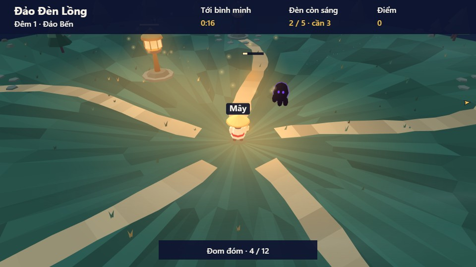

# Đảo Đèn Lồng

Trò chơi WebGL 3D bằng tiếng Việt. Cùng Mây nhặt đom đóm, châm dầu và giữ đèn trên Đảo Bến, Đảo Cau và Đảo Chuông sáng tới bình minh.



## Cài và chơi

Cần Node.js 20 trở lên, npm và trình duyệt có WebGL. Từ thư mục repo đã clone:

```sh
npm ci
npm start
```

Mở [Đảo Đèn Lồng](http://127.0.0.1:4173/). Trên PowerShell nếu `npm.ps1` bị chặn, dùng `npm.cmd` thay `npm`.

| Phím mặc định | Hành động |
| --- | --- |
| W, A, S, D hoặc phím mũi tên | Chạy theo góc nhìn |
| Q / R hoặc kéo chuột trên cảnh | Xoay góc nhìn |
| Phím cách | Nhảy |
| Shift | Lướt |
| E | Nạp ánh sáng, thắp lại hoặc châm dầu |
| F | Tỏa Sáng, tốn 3 đom đóm |
| Esc / P | Tạm dừng hoặc tiếp tục |

Đảo Bến dài 4 phút, Đảo Cau 4 phút 30 giây và Đảo Chuông 5 phút. Đến bình minh, Mây phải còn Ngọn Lửa và giữ ít nhất **3/5**, **4/6** hoặc **5/7** đèn sáng. Đèn mới cần 10 đom đóm và cần 5 để thắp lại. Đèn tự hao 1 dầu/giây, mỗi Bóng Mực đang hút làm hao thêm 5 dầu/giây. Dưới 30 dầu, đèn mất vùng trú và nhấp nháy. Túi tăng từ 10 lên tối đa 20 chỗ theo số lần thắp thành công.

## Trợ năng và bảng điểm

Chọn **Cài đặt → Đổi phím điều khiển** để gán từng hướng di chuyển, nhảy, Lướt, nạp, Tỏa Sáng và tạm dừng. Các phím bị trùng được báo ngay. **Khôi phục mặc định** đặt lại các phím. Cài đặt gồm **Bảng màu dễ phân biệt**, **Giảm chuyển động** và **Chữ lớn (125%)**, đổi cỡ chữ giao diện từ 18 lên 22,5 px. Giảm chuyển động bỏ các hiệu ứng chuyển động và nháy không cần thiết, giữ nguyên các chú thích về gió, Bóng Mực mới xuất hiện, 10 giây cuối và dầu thấp.

Sau khi thua hoặc hoàn thành cả ba đêm, nhập tên xếp hạng từ 3–12 ký tự. Chấp nhận chữ cái Unicode (gồm tiếng Việt có dấu), chữ số ASCII và dấu gạch dưới. Điểm xếp hạng chỉ cộng từ các đêm đã thắng. Khi bằng điểm, lượt đạt sớm hơn đứng trước. Xem 10 điểm cao nhất từ menu chính.

Launcher lưu kết quả trong `~/.dao-den-long/leaderboard.json` (Windows dùng thư mục người dùng). Có thể đặt đường dẫn khác bằng biến `LANTERN_LEADERBOARD`. Bản triển khai web tĩnh dùng bộ nhớ trình duyệt của địa chỉ đó. Lệnh dưới đây xuất bảng điểm của launcher:

```sh
node src/serve.mjs --export-leaderboard diem.json
```

Mỗi đom đóm nạp/châm cộng 5 điểm, thắp mới cộng 100, thắp lại cộng 40. Tỏa Sáng cộng 5 cho mỗi Bóng Mực trúng đòn, hoặc 15 nếu nó đang hút dầu. Khi thắng, mỗi đèn còn sáng cộng 50 thêm phần nguyên lượng dầu và mỗi Ngọn Lửa còn lại cộng 50.

## Kiểm thử và phép đo

```sh
npm test
node src/headless.mjs --seed 42 --night 3 --ticks 18000 --out ket-qua.jsonl
node src/bench.mjs --seed 42 --duration 30 --out bench.json
node --expose-gc src/soak.mjs --seed 7 --nights 10 --out soak.json
```

- CLI headless hỗ trợ `--scenario`, `--inputs`, `--snapshot-every` và đêm 1–3. [Test Contract v1.3](game.contract.json) giữ mô hình 60 tick/giây. Trường `team` ghi MSSV và họ tên theo mẫu `mssv-ho-ten`. `score.per_second_left` là `null` vì không có thưởng thời gian.
- Benchmark cần Chrome, Chromium hoặc Edge và desktop đồ họa. Dùng `LANTERN_BROWSER` nếu trình duyệt ở đường dẫn khác. Launcher đặt khung nội dung 1280×720 và mặc định tắt giới hạn khung hình/vsync bằng cờ Chromium. Đặt `LANTERN_VSYNC=on` để chạy đối chiếu có vsync. Giá trị p95 dùng phương pháp **nearest-rank**. `peak_mem_mb` là `null` vì web không có RSS của tổng các tiến trình trình duyệt. [Mã cờ Chromium](https://chromium.googlesource.com/chromium/src/%2B/HEAD/components/viz/common/switches.cc)
- Soak dùng RSS, tính theo MiB dù trường hợp đồng mang hậu tố `_mb`. Cùng quy trình GC ở hai mốc giúp so sánh sau thu gom. Xem [số đo, log kiểm thử và cài đặt sạch](docs/proof/phase-4/README.md).

## Sáng tạo của tôi

Giữ quầng xoắn đom đóm, nhạc nền đổi tông theo đảo và tên hiển thị trên đầu Mây. Có thể chọn tệp **honeybee** của Olivia Rodrigo hoặc tệp âm thanh khác trong **Cài đặt → Nhạc nền** để phát cục bộ trong phiên. Benchmark tắt các hiệu ứng bổ sung riêng của trò chơi. [Đối chiếu headless](docs/proof/phase-4/headless.log) ghi đầu ra giống byte với Phase 3 trên hai lượt kiểm tra.

[Danh sách bước phát hành](docs/release/README.md) · [Giấy phép hiện tại](LICENSE) · [Ghi công](CREDITS.md)
